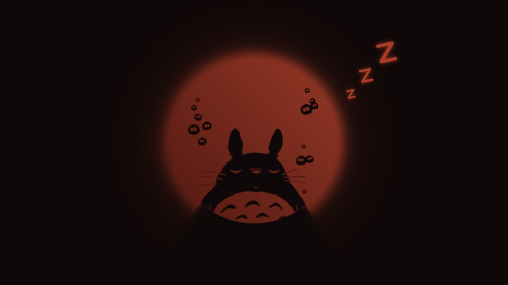
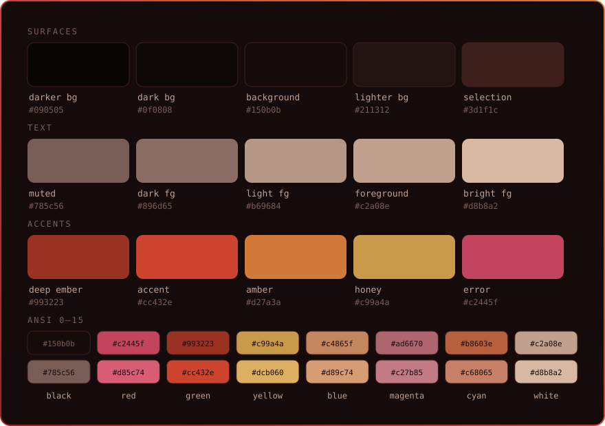
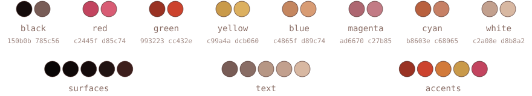
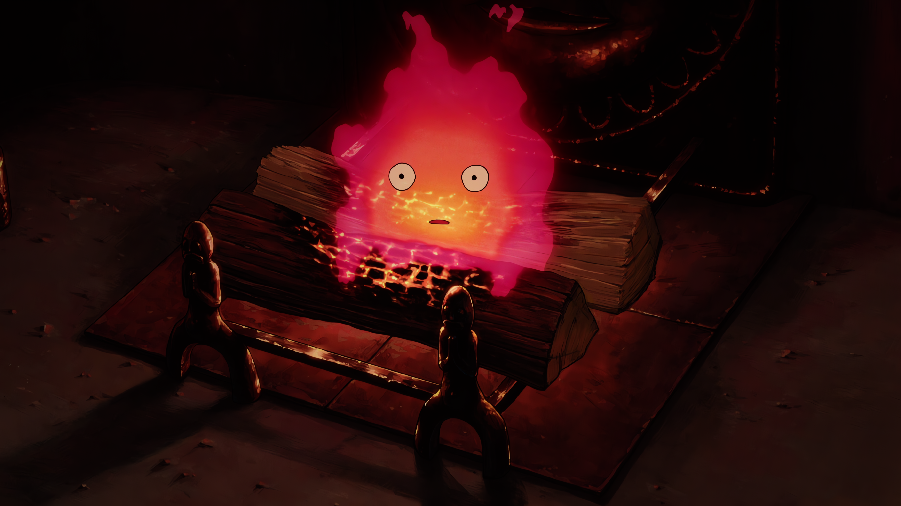
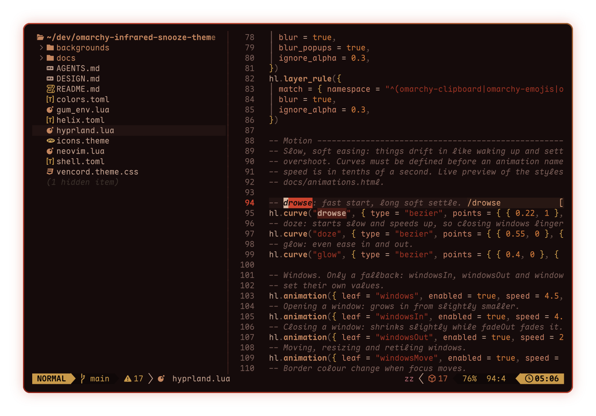
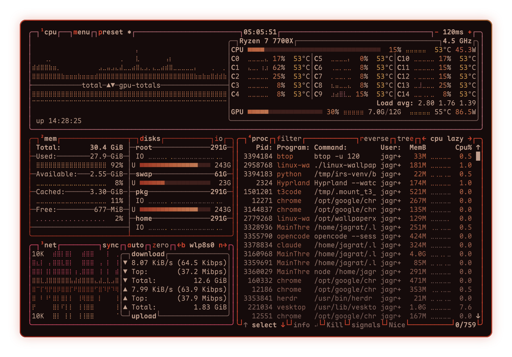
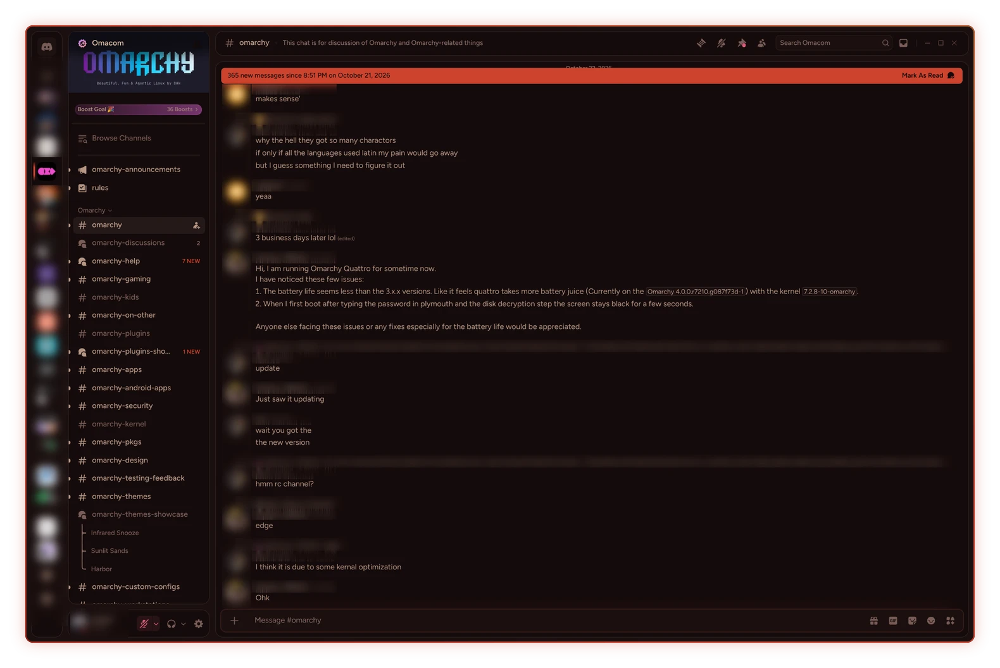

# Infrared Snooze

A warm dimmed, dark Omarchy theme made for winding down before bed. No blue tones,
just warm reds, embers and soft dusty colours that are easy on the eyes.




<!--<p align="center">
  
</p>-->




## Why red and dim?

Your body clock is most sensitive to blue light, around 460 to 480 nm, and
much less to red ([Brainard 2001](https://doi.org/10.1523/JNEUROSCI.21-16-06405.2001)).
But colour alone isn't enough: a warmer screen at full brightness still
suppresses melatonin ([Nagare 2019](https://doi.org/10.1177/1477153517748189)),
so the theme is kept dim too.

Pair it with the [Darky](https://github.com/jagrat7/mehiel.darky) plugin to
have the theme auto apply close to your bedtime.


## Install

Currently (4.0.6) `omarchy theme install` drops every `.lua` file and the terminal configs, so
you lose the Hyprland look and everything. Clone and
link the repo instead.

### Clone and link

```bash
mkdir -p ~/custom-themes
git clone https://github.com/jagrat7/omarchy-infrared-snooze-theme ~/custom-themes/infrared-snooze
ln -sT ~/custom-themes/infrared-snooze ~/.config/omarchy/themes/infrared-snooze
omarchy theme set infrared-snooze
```
Or use [theme-link](https://github.com/ministry-of-taste/theme-link)


### Official way (skip till they fix it):
```bash
omarchy theme install https://github.com/jagrat7/omarchy-infrared-snooze-theme
```
## Wallpapers

<table align="center">
  <tr>
    <td></td>
    <td></td>
    <td></td>
  </tr>
</table>
<table align="center">
  <tr>
    <td></td>
    <td></td>
  </tr>
</table>

## In the terminal

<table align="center">
  <tr>
    <td align="center"><a href="docs/nvim.png"></a><br><sub>Neovim</sub></td>
    <td align="center"><a href="docs/btop.png"></a><br><sub>btop</sub></td>
  </tr>
</table>

## Vesktop

<a href="docs/vesktop.webp"></a>
